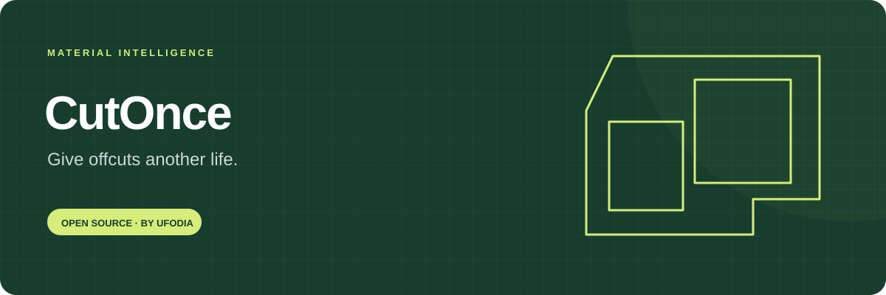
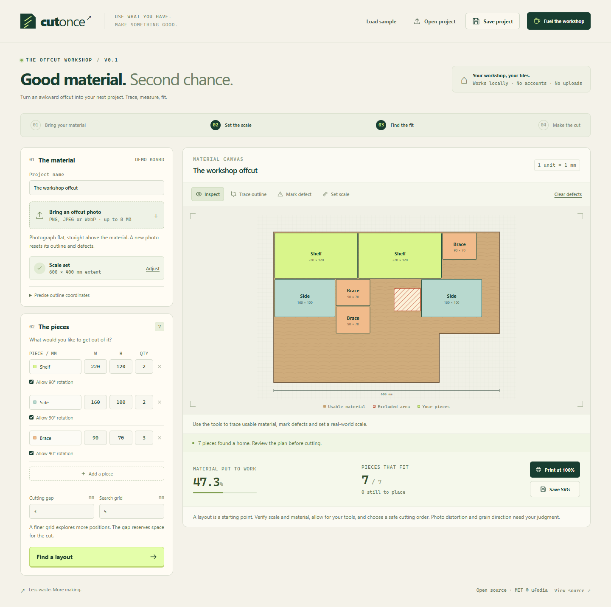

<p align="center">
  
</p>

# CutOnce

[](https://github.com/ufodia/cutonce/actions/workflows/checks.yml)
[](LICENSE)
[](docs/privacy.md)

**Find useful parts inside an awkward offcut.** Trace a photographed piece of material, mark defects, and turn a rectangular parts list into a measured layout you can take to your workbench.

[First layout](docs/guide.md) · [How it works](docs/architecture.md) · [Contribute](CONTRIBUTING.md) · [MIT license](LICENSE)

<p>
  <a href="https://buymeacoffee.com/ufodia"></a>
</p>



## Make the material you already have go further

A useful offcut rarely arrives as a perfect rectangle. CutOnce starts with its actual outline: a corner missing, a patch you cannot use, or a shape left over from another project. You describe what you need; the planner looks for a layout within those boundaries.

The application runs locally in your browser. You do not need an account, upload your workshop photos, or connect a CAD service.

| Bring                                             | Define                                                         | Plan                                                | Take away                                                |
| ------------------------------------------------- | -------------------------------------------------------------- | --------------------------------------------------- | -------------------------------------------------------- |
| A PNG, JPEG or WebP photo, or the included sample | Material boundary, defects, measurements and rectangular parts | A repeatable layout with rotation and kerf settings | A saved project, a measured SVG, or tiled A4 print pages |

## Start with a real working example

Install **Node.js 24 LTS** and Git, then run:

```sh
git clone https://github.com/ufodia/cutonce.git
cd cutonce
npm ci
npm run dev
```

Open the local address printed by Vite. The included sample is ready to explore: choose **Find a layout**, inspect the placed and unplaced pieces, then try **Save SVG** or **Save project**. No photograph is required for this first layout.

On Windows, use `npm.cmd` if PowerShell blocks `npm.ps1`. For your own material, follow the [photo-to-print guide](docs/guide.md).

You can also reopen the [included sample project file](examples/workshop.cutonce.json) through **Open project**.

## What you can do in 0.1.0

- Import a local material photo and draw its outline.
- Mark unusable regions as defect polygons.
- Calibrate coordinates from two points and a known distance in millimetres.
- Set rectangular part dimensions, quantities, and permitted 90° rotation.
- Adjust kerf and search-grid spacing, then generate a deterministic layout.
- Inspect utilization and a list of parts the planner could not fit.
- Save and reopen project JSON, export a dimensioned SVG, or prepare tiled A4 pages.

## Measure the result before you cut

CutOnce uses a bounded, greedy search. It finds useful arrangements; it does not prove the best possible yield. A part that remains unplaced may fit in another arrangement or may not have been fully searched before the work limit. Utilization is placed-part area divided by the full material-boundary area, including excluded defects.

Photograph perspective, an inaccurate reference measurement, printer scaling, and real material defects can all change the result. Photograph the material square-on, verify dimensions on the material, and measure the printed **100 mm ruler** before using a template. Layouts do not specify a safe or feasible cutting sequence. CutOnce does not generate CNC toolpaths or G-code.

## Built for inspection and adaptation

The core is plain TypeScript with separate geometry, validation, nesting, and export functions. Vite serves and builds the browser interface; tests exercise the planning rules and user workflows.

```sh
npm run verify
npx playwright install --no-shell chromium
npm run test:e2e
```

`verify` runs type checking, unit tests, and a production build. Browser tests require Playwright's Chromium installation; see the [testing guide](docs/testing.md). Check that guide for the verification boundary rather than assuming support for every browser or printer.

To inspect the compiled application locally, run `npm run build` followed by `npm run preview`. Vite prints the preview address; serve the build over HTTP rather than opening `dist/index.html` directly.

| Documentation                                       | What you will find                                           |
| --------------------------------------------------- | ------------------------------------------------------------ |
| [Photo-to-print guide](docs/guide.md)               | Calibration, editing, planning, printing and troubleshooting |
| [Architecture](docs/architecture.md)                | Data flow, module boundaries and algorithm trade-offs        |
| [Project and function reference](docs/reference.md) | Saved data and the public core contract                      |
| [Privacy](docs/privacy.md)                          | What stays local and what exported files contain             |
| [Testing](docs/testing.md)                          | Reproducible checks and unverified conditions                |
| [Restore from GitHub](docs/restore.md)              | Rebuild the project on a replacement computer                |

## Support a useful little workshop tool

If CutOnce helps you turn leftover material into something useful, you can [buy ufodia a coffee](https://buymeacoffee.com/ufodia). Support is voluntary and funds maintenance, fixes, documentation, and new workshop workflows. The same source and features remain available to everyone.

Contributions are welcome: a small reproducible geometry case is especially useful. Read [CONTRIBUTING.md](CONTRIBUTING.md) before opening a change, and use [SECURITY.md](SECURITY.md) for sensitive reports.

## License

[MIT](LICENSE) · Copyright © 2026 **ufodia**.

CutOnce is an independent project. You retain responsibility for your measurements, material, tools, and cutting decisions.
