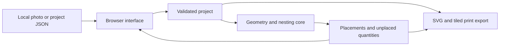

# Architecture and design decisions

CutOnce 0.1.0 is a browser-local planning application. It separates a small pure TypeScript core from browser input, rendering, downloads, and print-window behavior.

## Boundaries

| Area                | Responsibility                                                                                              |
| ------------------- | ----------------------------------------------------------------------------------------------------------- |
| `src/core.ts`       | Project types, validation, geometry, deterministic placement, SVG and print-document generation             |
| `src/main.ts`       | Input controls, drawing interaction, calibration, result invalidation, file import/download, and print view |
| `src/style.css`     | Workspace layout, readable controls, focus and responsive presentation                                      |
| `tests/` and `e2e/` | Core behavior and browser-workflow regression checks                                                        |
| `docs/assets/`      | Repository presentation artwork and application screenshots                                                 |

The core does not depend on the DOM, a database, a remote service, or the UI framework. The interface calls the core with a project and renders its result. A change to the input requires a new result before exporting a current layout.

## Coordinates and calibration

A calibrated project uses millimetres in a two-dimensional coordinate plane. Width and height refer to the material plane rather than the photograph's physical print size. Photo import initially uses image coordinates; two selected points and a reference length establish a uniform conversion to millimetres.

The same conversion must apply to boundary points, defects, and photo display extents. It cannot recover depth, compensate for perspective, or establish real-world measurement accuracy.

## Placement strategy

The planner processes part types by descending part area, then places their requested copies. It considers regular-grid positions and candidates derived from material vertices, defects and already placed edges. Rotation is limited to 90° and follows each part type's permission.

A candidate must fit inside the material polygon, remain outside excluded regions, and respect configured clearance. Checking corners alone would be insufficient for a concave board: a rectangle can bridge an empty notch even when its corners lie inside. Core tests should preserve this distinction.

The search is deliberately deterministic and bounded: the regular grid is thinned to roughly 110 candidates per axis before edge-derived positions are added, and a run has a 250,000-candidate check budget. This keeps an interactive local application understandable and reproducible, at the cost of potentially missing feasible or better layouts. Unplaced counts include pieces not found within that budget. The engine does not provide a global optimum, guillotine-cut guarantee, tool-access analysis, or cutting order.

The utilization ratio is `partArea / boardArea`. `boardArea` is the gross polygon area, including defect regions; it is not the remaining usable area after subtracting defects.

## File and export boundary

Project JSON is untrusted input. Validation must reject malformed coordinates, invalid dimensions, unsupported versions, oversized inputs, and unsupported image data. Names are data and must be escaped when included in HTML or SVG.

The project may embed a raster photo. The SVG and print exporters use physical dimensions rather than relying on screen pixels. The print document tiles the layout across A4 pages and provides a ruler so you can test the physical result.

## Accepted trade-offs

- **Browser-local state:** no account, service database or upload path is required. You save a project file to preserve your work.
- **Manual geometry:** you decide the boundary and defects. The application avoids presenting image interpretation as a reliable material measurement.
- **Simple parts:** rectangular parts make the first planning model inspectable. Arbitrary part polygons and CNC output are outside 0.1.0.
- **Vector exports:** measured SVG and printable pages are portable. Accuracy still depends on viewers, print settings and physical verification.

See [reference.md](reference.md) for the data contract and [testing.md](testing.md) for its verification boundary.
